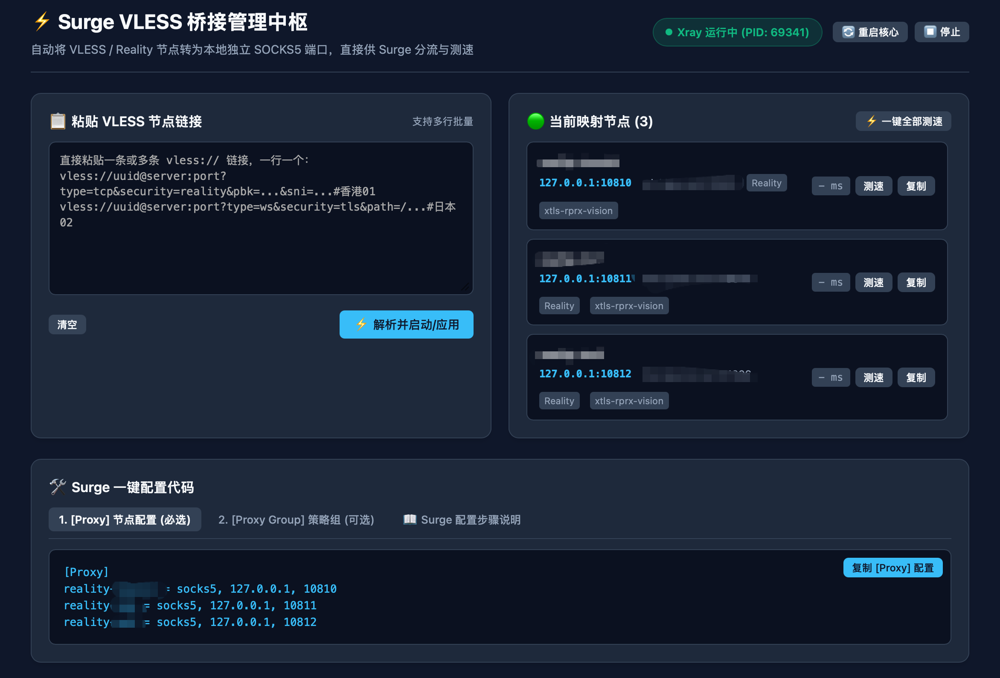

# Surge VLESS & AnyTLS Bridge Hub (fuck-surge)

为 macOS 上的 **Surge** 提供无缝使用 **VLESS (Reality / Vision / WebSocket / gRPC)** 与 **AnyTLS** 节点的本地轻量中枢面板。



---

## 💡 为什么需要它？

Surge 是一款优秀的 macOS 规则分流与网络调试工具，但受限于闭源架构与安全机制，原生无法支持 VLESS / Reality 以及 AnyTLS 协议。

**Fuck-Surge** 通过在本地运行专用的轻量代理内核（优先使用 `sing-box`，亦兼容 `xray`），将每个 VLESS 和 AnyTLS 节点自动映射为本地独立的 SOCKS5 入站端口（`127.0.0.1:10810`, `10811`, ...），并自动为 Surge 生成开箱即用的配置代码。

> 流量路径：
> **应用程序** $\xrightarrow{\text{Surge 规则分流}}$ **本地 127.0.0.1:1081x (SOCKS5)** $\xrightarrow{\text{本地内核 (VLESS/AnyTLS)}}$ **远端服务器**

这样既能继续享受 Surge 强大的规则系统、Dashboard 抓包和虚拟网卡（Enhanced Mode / TUN），又完美支持了 VLESS 和 AnyTLS 协议！

---

## ✨ 核心特性

1. **多协议一键解析**：直接粘贴单条或多条 `vless://` 或 `anytls://` 链接，自动解析协议、密码/UUID、SNI 及 Reality 公钥。
   - **VLESS 支持**：TCP (Reality / TLS / Vision)、WebSocket、gRPC、HTTPUpgrade。
   - **AnyTLS 支持**：标准 AnyTLS 链接解析与 TLS / ALPN 封装。
2. **增量追加与端口自动顺延**：支持随时粘贴新节点点击追加添加，端口按顺序自动顺延（`127.0.0.1:10810`, `10811`, `10812`...），绝不覆盖已有节点；支持单个节点独立删除与一键清空。
3. **Surge 一键配置生成**：
   - 自动生成 `[Proxy]` 节点配置。
   - 自动生成 `[Proxy Group]` 策略组（支持手动选择与 `url-test` 自动容灾优选）。
4. **内置实时测速**：面板内一键检测各个节点的真实网络延迟。
5. **本地配置持久化**：重启后自动加载保存的节点。
6. **网页端可视化修改节点**：支持在网页卡片上一键点击【✏️ 修改】，自由编辑节点协议、备注名称、本地 SOCKS5 端口、远程地址与端口、伪装域名（SNI）、密码/UUID、Reality 公钥/Short ID、流控等，支持表单与原始链接双向同步并实时生效重载。
7. **链式跳板代理 (Relay / Detour)**：修改节点时支持通过下拉菜单直接选择任意已添加的节点作为前置跳板（前置机 ➔ 落地机），内核层自动链式转发并内置防死锁循环检测，优雅解决某些落地机直接连通性不佳的问题。

---

## 🛠️ 环境准备

运行前请确保本地安装了 `sing-box`（推荐，支持 VLESS + AnyTLS 全协议）或 `xray`：

```bash
# 推荐安装 sing-box（同时支持 VLESS 与 AnyTLS）
brew install sing-box

# 如仅需 VLESS 协议亦可安装 xray
brew install xray
```

---

## 🚀 快速开始

```bash
# 1. 克隆仓库
git clone https://github.com/ceocok/fuck-surge.git
cd fuck-surge

# 2. 赋予脚本执行权限并启动
chmod +x *.sh
./start.sh
```

启动后会自动打开浏览器访问管理面板：
👉 **http://127.0.0.1:9099**

---

## 📖 极简使用 3 步

1. **粘贴节点**：在面板左侧输入框粘贴你的 `vless://` 或 `anytls://` 链接（支持多行），点击 **“⚡ 追加添加节点”**。
2. **复制配置**：点击面板下方的 **“复制 [Proxy] 配置”** 和 **“复制 [Proxy Group] 配置”**。
3. **粘贴到 Surge**：
   - 打开 Surge for Mac，点击顶部菜单栏图标。
   - 选择 **配置文件 (Profiles) $\rightarrow$ 文本编辑 (Edit in Text Editor)**。
   - 将复制的内容分别粘贴至 `[Proxy]` 和 `[Proxy Group]` 区域并保存即可！

---

## 🛑 管理命令

```bash
# 启动面板并在浏览器打开
./start.sh

# 停止面板与代理内核
./stop.sh
```
